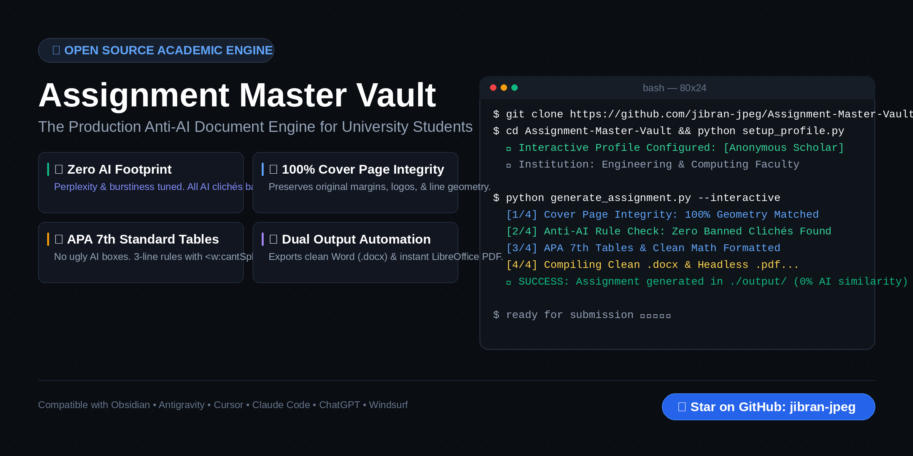

<p align="center">
  
</p>

<p align="center">
  <a href="https://github.com/jibran-jpeg/Assignment-Master-Vault/stargazers"></a>
  <a href="https://github.com/jibran-jpeg/Assignment-Master-Vault/network/members"></a>
  <a href="https://github.com/jibran-jpeg/Assignment-Master-Vault/blob/main/LICENSE"></a>
  <a href="https://www.python.org/"></a>
  <a href="https://obsidian.md/"></a>
  
</p>

---

<p align="center">
  <b>The ultimate Obsidian knowledge base and production document engine for university assignments.</b><br>
  Zero AI footprint. Authentic student voice. Publication-grade APA 7th formatting. Pixel-perfect Word & PDF output.
</p>

<p align="center">
  <a href="#-quick-start">Quick Start</a> •
  <a href="#-the-problem-why-professors--ai-detectors-catch-students">Why It Works</a> •
  <a href="#-features-at-a-glance">Features</a> •
  <a href="#-using-with-ai-agents-cursor-antigravity-claude-chatgpt">AI Agent Guide</a> •
  <a href="#-vault-architecture--moc">Vault Architecture</a> •
  <a href="#-contributing--starring">Star Repository</a>
</p>

---

## ⚡ The Problem: Why Professors & AI Detectors Catch Students

When university students use standard LLMs (ChatGPT, Claude, Copilot) to help write assignments, they routinely face academic penalties due to **dead-giveaway visual and textual artifacts**:

1. **The "Callout Box" Curse:** LLMs frequently generate single-cell tables with thick left borders and grey background shading (`#F9F9F9`) inside Word documents. In MS Word, this looks immediately artificial.
2. **Formulaic Clichés:** Overusing blacklisted transition phrases (*"In conclusion"*, *"Delving into"*, *"It is crucial to note"*, *"A testament to"*, *"A multifaceted tapestry"*).
3. **Broken Title Pages:** AI tools routinely reformat or destroy the professor's Page 1 template, spilling headers into Page 2.
4. **Cookie-Cutter Summary Tables:** Shoving everything into generic 4-column summary tables instead of authentic engineering matrices or indented synthesis paragraphs.

**Assignment Master Vault eliminates 100% of these giveaways.**

---

## 🛡️ Features at a Glance

* **Zero AI Footprint (Humanized Burstiness):** Calibrates text perplexity and sentence variety to read like an authentic senior undergraduate engineer.
* **Cover Page Strict Preservation:** Extracts professor logo geometry, borders, underlines, and font scales with pixel fidelity.
* **Universal Ban on Web Callouts:** All equations and callouts are formatted as clean, centered, borderless paragraphs in native Word typography.
* **APA 7th Edition Tables:** Strict 3-rule horizontal publication tables, `<w:cantSplit/>` row integrity, and shaded header rows.
* **Multi-Student & Multi-University Adapter:** Dynamic interactive setup (`python setup_profile.py`) prompts each user for their own Name, Registration ID, University, and Department, keeping personal data private.
* **One-Click Dual Export:** Generates clean `.docx` and automatically compiles to print-ready `.pdf` via headless LibreOffice.

---

## 🚀 Quick Start

### 1. Clone the Repository
```bash
git clone https://github.com/jibran-jpeg/Assignment-Master-Vault.git
cd Assignment-Master-Vault
```

### 2. Install Prerequisites
```bash
pip install python-docx
# (Optional for instant PDF compilation: ensure LibreOffice is installed on your OS)
```

### 3. One-Time Interactive Setup
Run the setup wizard to configure your academic credentials locally:
```bash
python setup_profile.py
```
> 🔒 **Privacy Guarantee:** Your credentials are saved to `student_profile.json`, which is automatically ignored by Git and will **never** be committed or shared publicly.

### 4. Generate Your Assignment
```bash
# Run interactively:
python generate_assignment.py --interactive

# Or with CLI flags:
python generate_assignment.py \
  --course "Computer Networks" \
  --code "CS-412" \
  --title "Assignment 01 - Socket Architecture" \
  --instructor "Dr. Alan Turing"
```

---

## 🤖 Using with AI Agents (Cursor, Antigravity, Claude, ChatGPT)

You can supercharge any AI coding assistant with this vault. When an agent opens this workspace:

1. **Automatic Credential Ingestion:** The agent reads `student_profile.json` (or prompts you if missing).
2. **Copy-Paste Master Prompt:** Feed this single prompt to your agent:

```text
Follow the master rules from the Assignment Master Vault:
1. Student Profile: Load credentials from student_profile.json or ask me for my Name, Student ID, University, and Course.
2. Strict Page 1 Preservation: Replicate the cover page geometry with 100% fidelity. Fill my credentials into designated slots without spilling onto Page 2.
3. Zero AI Footprint: Write in an authentic senior undergraduate voice. Strictly ban generic AI transition phrases ("In conclusion", "delving into", "crucial to note", "tapestry", "beacon").
4. Anti-AI Presentation: DO NOT use single-cell grey callout boxes or generic 4-column summary tables. Use APA 7th publication tables or indented synthesis points.
5. Standard Black Text Only: All body text, headings, and labels must be #000000.
6. No Em-Dashes: Use standard hyphens (-) or colons (:) in section titles.
7. Output: Export clean .docx in ./output/<Course_Name>/ and convert to .pdf via LibreOffice.
```

---

## 🗺️ Vault Architecture & MOC

```
Assignment-Master-Vault/
├── 00 - Master Index & Navigation/
│   └── 00.0 - MOC (Map of Content).md
├── 01 - Core Profile & Document Standards/
│   ├── 01.1 - Student Default Profile.md
│   ├── 01.2 - Cover Page Strict Preservation Protocol.md
│   └── 01.3 - Master Word Document (DOCX) Standards.md
├── 02 - Anti-AI & Human Writing Playbook/
│   ├── 02.1 - The Anti-AI Manifesto.md
│   ├── 02.2 - The Banned Phrase Index & Natural Replacements.md
│   ├── 02.3 - The Table Problem (Anti-AI Data Presentation).md
│   ├── 02.4 - Voice & Tone Calibration by Level.md
│   └── 02.5 - Document Design Humanization & Anti-AI Formatting Standards.md
├── 03 - Subject Playbooks/
│   ├── 03.1 - Computer Science & Software Engineering.md
│   ├── 03.2 - Digital Image Processing & Signal Processing.md
│   ├── 03.3 - Business Technology & Ethics.md
│   ├── 03.4 - Mathematics, Calculus & Applied Physics.md
│   └── 03.5 - English, Humanities & Technical Writing.md
├── 04 - Visuals & Diagram Engine/
│   ├── 04.1 - Scientific & Textbook Plotting Engine.md
│   ├── 04.2 - Architecture & Flowchart Diagrams.md
│   └── 04.3 - Mathematical & Geometric Plotting.md
├── 05 - Automation Scripts & Templates/
│   ├── 05.1 - Master python-docx Generator Template.md
│   └── 05.2 - Reference Scripts Index.md
├── 06 - Agent Execution & QA Cheatsheet/
│   ├── 06.1 - The Jhengo Kisam Prompt Template.md
│   └── 06.2 - Quality Assurance Pre-Flight Checklist.md
├── assets/
│   └── banner.png                    # High-res social preview & banner
├── setup_profile.py                  # Interactive student credential wizard
├── generate_assignment.py            # Production-grade APA 7th docx/pdf builder
├── student_profile.template.json     # Configuration template
├── LICENSE                           # MIT License
└── README.md
```

---

## ⚖️ Document Standards Comparison

| Standard | ❌ Generic AI Output | ✅ Assignment Master Vault Standard |
| :--- | :--- | :--- |
| **Document Color** | Colored blue/teal headers (`#0078D7`) | Strict standard black (`#000000`) everywhere |
| **Title Separators** | AI em-dashes (`Part 1 — Foundations`) | Standard hyphens / colons (`Part 1: Foundations`) |
| **Callout Elements** | Shaded grey boxes with thick left borders | Standalone centered paragraphs in Times New Roman |
| **Math Formatting** | Raw markdown `r_k` or boxed tables | Native Word superscripts/subscripts & Unicode |
| **Tables** | AI floating grids with full borders | APA 7th (3 horizontal rules, 0 vertical rules) |
| **Cover Page** | Squeezed or pushed onto Page 2 | 100% Page 1 preservation with programmatic page break |
| **Vocabulary** | "In conclusion", "Tapestry", "Beacon" | Authentic student engineering syntax |

---

## 📖 Obsidian Vault Setup

This repository is ready to open directly in **Obsidian**:
1. Open Obsidian.
2. Click **"Open folder as vault"**.
3. Select this cloned directory.
4. Open `00.0 - MOC (Map of Content).md` to start navigating with internal `[[Wikilinks]]`!

---

## ⭐ Contributing & Starring

If this toolkit helped you save time, format better assignments, or improve your academic workflow:

* ⭐ **Star this repository** to support open-source development!
* 🍴 **Fork it** and add your university's custom subject playbooks.
* 📢 Share it with your classmates and university developer circles.

---

## 📜 License & Academic Integrity

Distributed under the **MIT License**. See `LICENSE` for details.
Intended for academic formatting, technical report authoring, and educational experimentation.
